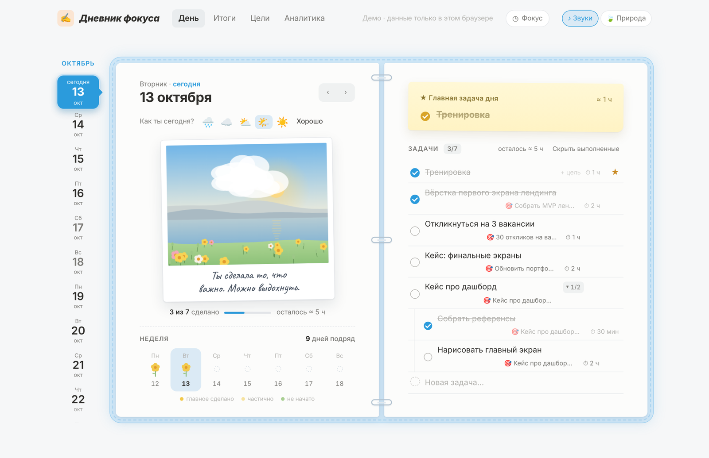
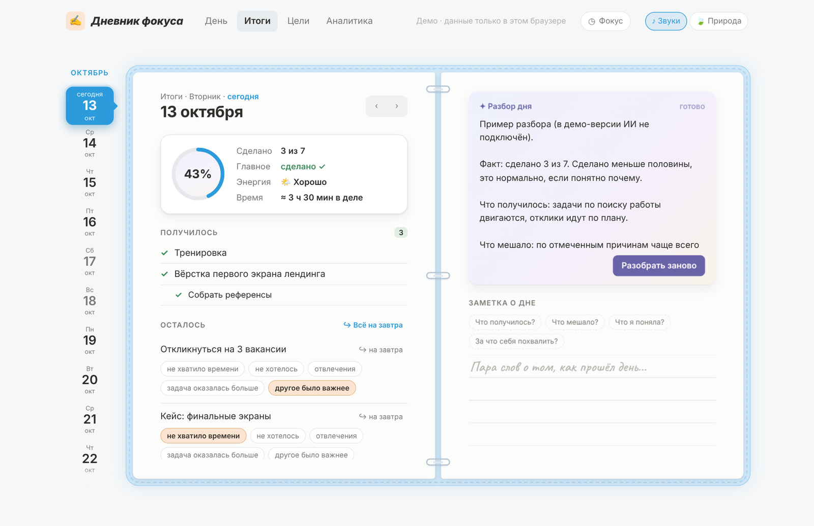
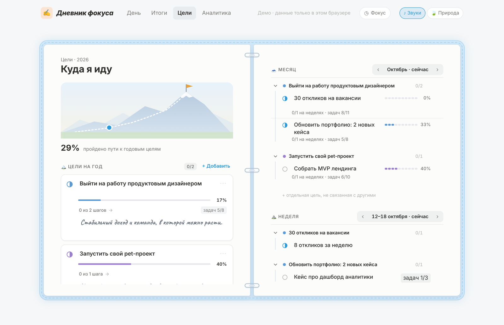
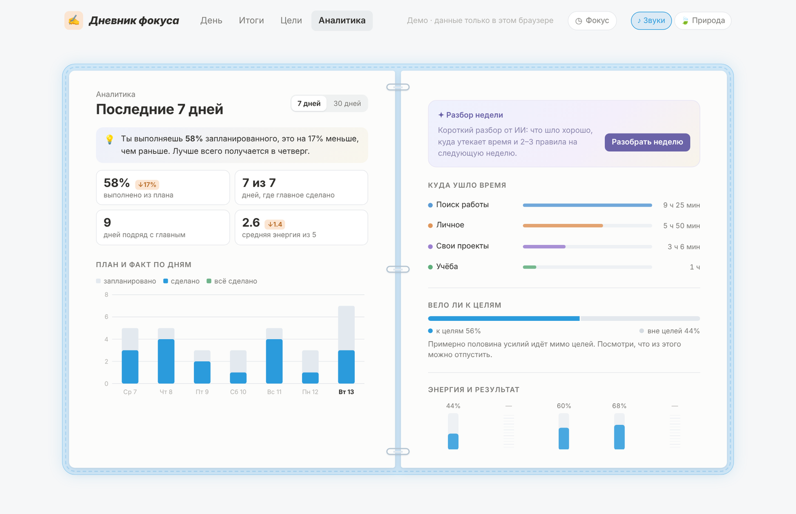
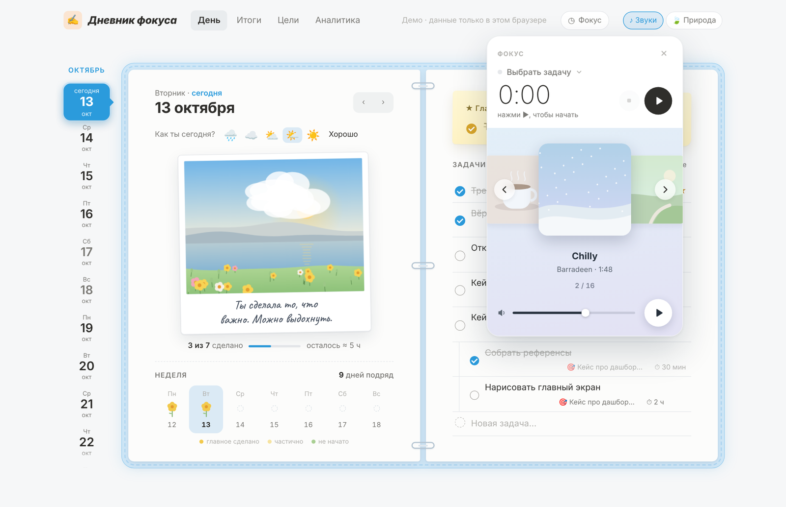
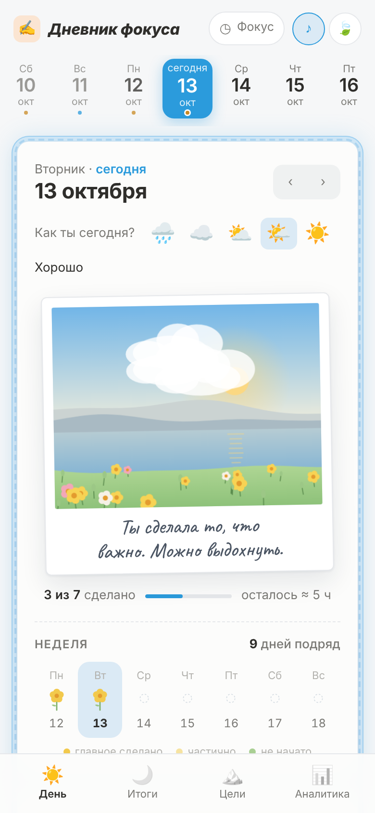

# Дневник фокуса

Личный дневник задач и целей для тех, кто берётся за многое сразу и ничего не доводит до конца. Спокойный, как бумажный ежедневник, но с аналитикой и вечерним разбором дня.

**[Открыть демо →](https://mari-uiux.github.io/focus-diary/)**



## Зачем

Когда параллельно идут несколько проектов, учёба и личные дела, легко распыляться: начинаешь многое, доводишь мало, а к вечеру непонятно, куда ушёл день. Обычные таск-трекеры решают это списками. Дневник фокуса отвечает на другие вопросы: двигают ли сегодняшние дела к главному и как честно посмотреть на итоги дня без чувства вины.

Три принципа:

- **Одна главная задача дня** вместо длинного списка приоритетов.
- **Каскад целей:** год → месяц → неделя → задачи дня. Видно, что из сделанного ведёт к цели, а что нет.
- **Спокойствие вместо давления.** Никаких красных просрочек и счётчиков стыда, вместо них пейзаж, который расцветает по мере выполнения задач.

## Разделы

### День
Слева состояние дня, справа задачи на линованной странице.

- **Пейзаж дня** рисуется на Canvas по данным: погода зависит от энергии, солнце поднимается вместе с прогрессом, за каждую сделанную задачу на лугу распускается цветок, вечером небо розовеет, ночью появляются звёзды.
- **Сад недели:** каждый день недели — цветок, бутон или пустая земля. Видно ритм, а не только цифры.
- **Задачи как в Notion:** запись в любой пустой строке, Enter создаёт следующую, Tab делает подзадачу, перетаскивание, меню действий. Свойства задачи (цель, время) в аккуратных всплывающих списках.
- **Главная задача дня** закреплена жёлтым стикером сверху.

### Итоги
- Сначала блок «Получилось», потом «Осталось»: итог дня начинается с того, что удалось.
- Причина невыполнения выбирается в один клик, перенос на завтра поштучно или всем списком.
- Заметка о дне пишется рукописным шрифтом прямо по линиям, с подсказками «Что мешало?», «Что я поняла?».
- Разбор дня от ИИ: факт, причины, повторяющиеся паттерны и один шаг на завтра.



### Цели
- Цели привязаны к реальным периодам: этот год, октябрь, неделя 12–18 октября, со стрелками для перехода между ними.
- Месячные цели сгруппированы под годовыми, недельные под месячными. У каждой годовой цели свой цвет, он тянется через все уровни.
- Прогресс считается сам: по шагам ниже или по привязанным задачам дня.
- Фокус на одной цели оставляет на странице только её ветку.
- Мягкое ограничение: если целей больше разумного, дневник спокойно предлагает что-то поставить на паузу.



### Аналитика
- Вывод словами сверху вместо голых цифр: «Ты выполняешь 58% запланированного, лучше всего получается в четверг».
- План и факт по дням, куда ушло время по проектам, доля сделанного, которая вела к целям.
- Энергия и результат: насколько выполняется план при разном самочувствии.
- Разбор недели от ИИ сворачивается в превью из двух строк.



### Фокус: таймер и музыка
- Таймер на задачу: запускается из строки задачи или из панели в шапке, потраченное время записывается в задачу и попадает в аналитику.
- Плеер с перелистыванием обложек, как карусель альбомов. 13 спокойных треков и три генеративных «радио», которые сочиняются прямо в браузере через Web Audio.



## Детали

- Перелистывание страниц стрелками: лист отгибается от уголка и переворачивается через корешок, со звуком бумаги.
- Тихие синтезированные звуки интерфейса: щелчок колёсика при прокрутке дней, колокольчик при выполнении задачи (нота выше с каждой задачей дня), перезвон, когда главное сделано.
- Фон природы по желанию: ветер и птицы, в пасмурный день тихий дождь, поздно вечером сверчки.
- Мобильная версия: нижняя панель вкладок, горизонтальная лента дней, плеер в шторке снизу.



## Как устроено

Один файл `index.html`: HTML, CSS и JavaScript без фреймворков и сборки.

- **Canvas** — пейзаж дня.
- **SVG** — обложки треков, сад недели, графики, вершина целей.
- **Web Audio API** — звуки интерфейса, природа и генеративная музыка.
- **localStorage** — данные в демо-версии.

Основная версия, которой я пользуюсь сама, работает как приложение на claude.ai: данные синхронизируются в облаке между компьютером и телефоном, а разбор дня и недели делает Claude. В демо ИИ-разборы заменены примерами текста.

## Запустить у себя

```bash
git clone https://github.com/mari-uiux/focus-diary.git
cd focus-diary
python3 -m http.server 8000
```

Открой http://localhost:8000. Простой локальный сервер нужен, чтобы браузер разрешил загрузку треков. Без музыки `index.html` можно открыть и двойным кликом.

## Музыка

Треки распространяются бесплатно, все права у авторов:

| Трек | Автор |
|---|---|
| Hot Coffee, Subtle Break | Ghostrifter Official |
| Chilly, Walking Together, The Girl I Haven't Met, First Girl Talking To Me, I Can't Take My Eyes Out Of You | Barradeen |
| Antidepresseur, Intermezzo | Friendzoned |
| Tinyevil | Deoxys Beats |
| It Meant Everything To Me | Le Gang |
| Без названия · 1, Без названия · 2 | автор не указан |

Если ты автор трека и хочешь, чтобы его убрали или подписали иначе, напиши в Issues.

## Автор

Маша, продуктовый UI/UX-дизайнер. Дизайн, UX и код: я вместе с Claude.
